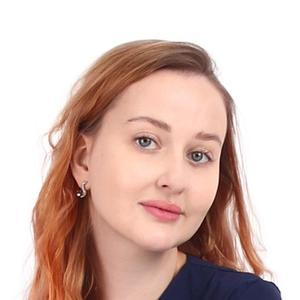
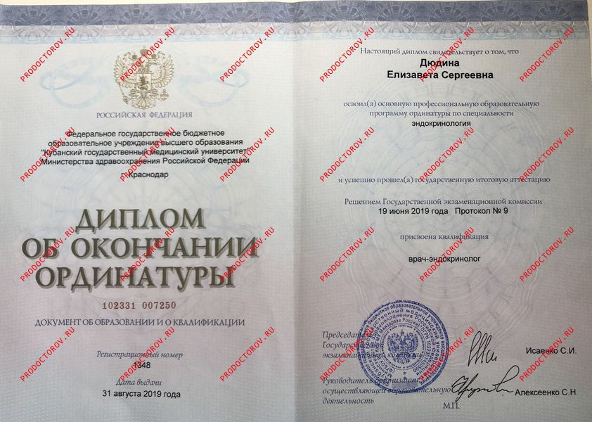

<!-- <!DOCTYPE html> -->
<html lang="ru">
<head>
    <meta charset="UTF-8">
    <meta name="viewport" content="width=device-width, initial-scale=1.0">
    <title>Врач-эндокринолог Камышанова Е.С. — онлайн-приём</title>
    
</head>
<body>

<header>
    
Камышанова Е.С.

    <nav>
        <a href="#services">Услуги</a>
        <a href="#about">Обо мне</a>
        <a href="#faq">FAQ</a>
    </nav>
    <!-- Кнопка в шапке (видна на ПК) -->
    <a href="#contact" class="btn">Записаться</a>
</header>

<!-- Мобильная кнопка внизу экрана -->

    <a href="#contact" class="btn">Записаться на приём</a>

<section class="hero">
    

        <!-- Замените src на путь к фото: images/doctor.jpg -->
        
    

    <h1>Камышанова Елизавета Сергеевна Врач-эндокринолог</h1>
    
Онлайн-консультации по вопросам щитовидной железы, диабета, коррекции веса и гормонального фона. Приём с разбором анализов и персональными рекомендациями.

    <a href="#contact" class="btn" style="padding: 1rem 2rem; font-size: 1.1rem;">Записаться на приём</a>
</section>

<section id="services">
    <h2>Услуги</h2>
    

        

            <h3>Консультация по щитовидной железе</h3>
            
Оценка состояния, интерпретация анализов, подбор плана наблюдения и коррекции.

        

        

            <h3>Диабетология и инсулинорезистентность</h3>
            
Разбор углеводного обмена, рекомендации по питанию и образу жизни, контроль показателей.

        

        

            <h3>Коррекция веса и метаболизма</h3>
            
Анализ гормональных причин набора веса, индивидуальный план коррекции и контроля.

        

        

            <h3>Разбор анализов и динамики</h3>
            
Интерпретация лабораторных данных, оценка динамики и прогноз изменений.

        

        

            <h3>Повторные приёмы и сопровождение</h3>
            
Контроль терапии, коррекция дозировок, ответы на вопросы в динамике.

        

        

            <h3>Рекомендации по образу жизни</h3>
            
Индивидуальные советы по питанию, физической нагрузке и режиму дня.

        

    

</section>

<section id="about">
    <h2>О враче</h2>
    

        

            
<strong>Камышанова Елизавета Сергеевна</strong> — врач-эндокринолог с клиническим опытом более 8 лет. Специализируется на диагностике и терапии заболеваний эндокринной системы, коррекции метаболических нарушений и сопровождении пациентов в долгосрочной динамике.

            
Регулярно повышает квалификацию, участвует в профильных конференциях, ориентируется на доказательную медицину и индивидуальный подход к каждому пациенту.

            <ul style="margin-top: 1rem;">
                <li>✅ Стаж: более 8 лет</li>
                <li>✅ Более 1 200 консультаций</li>
                <li>✅ Специализация: щитовидная железа, диабет, вес, гормоны</li>
            </ul>
        

        

            <!-- Замените src на путь к сертификатам: images/certs.jpg -->
            
        

    

</section>

<section id="faq">
    <h2>Часто задаваемые вопросы</h2>
    

        
Как проходит онлайн-приём?

        
Приём проходит по видеосвязи (Telegram/WhatsApp/Zoom). Перед консультацией вы отправляете анализы и жалобы, на приёме врач задаёт уточняющие вопросы, даёт рекомендации и при необходимости назначает дополнительные исследования.

    

    

        
Нужна ли подготовка к консультации?

        
Да: желательно прислать результаты анализов (ТТГ, Т4, глюкоза, инсулин и др.) и список жалоб. Это сэкономит время на приёме и сделает консультацию более точной.

    

    

        
Можно ли получить заключение и назначения?

        
По итогам приёма вы получаете письменное заключение с рекомендациями. Назначение лекарств и коррекция терапии возможны только при наличии показаний и после оценки состояния.

    

</section>

<section id="contact">
    <h2>Записаться на онлайн-приём</h2>
    <form id="appointment-form">
        

            <label for="name">Ваше имя</label>
            <input type="text" id="name" name="name" required placeholder="Иван Иванов">
        

        

            <label for="phone">Телефон</label>
            <input type="tel" id="phone" name="phone" required placeholder="+7 (999) 000-00-00">
        

        

            <label for="topic">Тема обращения</label>
            <select id="topic" name="topic">
                <option value="щитовидная железа">Щитовидная железа</option>
                <option value="диабет">Диабет / инсулинорезистентность</option>
                <option value="вес">Коррекция веса / метаболизм</option>
                <option value="анализы">Разбор анализов</option>
                <option value="другое">Другое</option>
            </select>
        

        

            <label for="time">Удобное время</label>
            <input type="text" id="time" name="time" placeholder="Например: пн, 18:00">
        

        

            <label for="comment">Комментарий / анализы</label>
            <textarea id="comment" name="comment" placeholder="Кратко опишите жалобы и прикрепите список анализов"></textarea>
        

        <button type="submit" class="btn" style="width: 100%;">Отправить заявку</button>
        
Нажимая кнопку, вы соглашаетесь с политикой обработки персональных данных.

    </form>
</section>

<footer>
    
Камышанова Елизавета Сергеевна, врач-эндокринолог

    
Контакты: +7 (XXX) XXX-XX-XX | email@example.com

    

        Консультация носит информационный характер и не является медицинской помощью. Для постановки диагноза и назначения лечения необходима очная консультация врача. Имеются противопоказания. Необходима консультация специалиста.
    

</footer>

</body>
</html>
